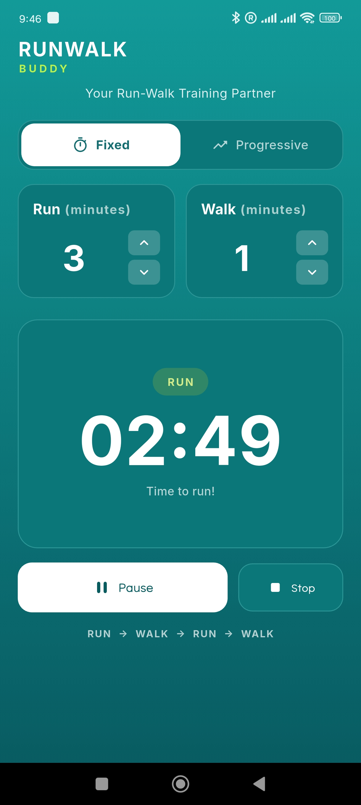
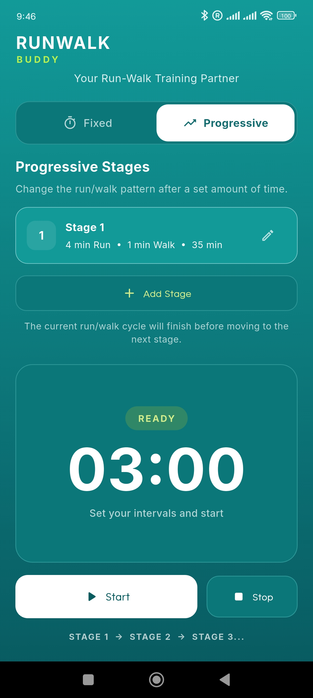
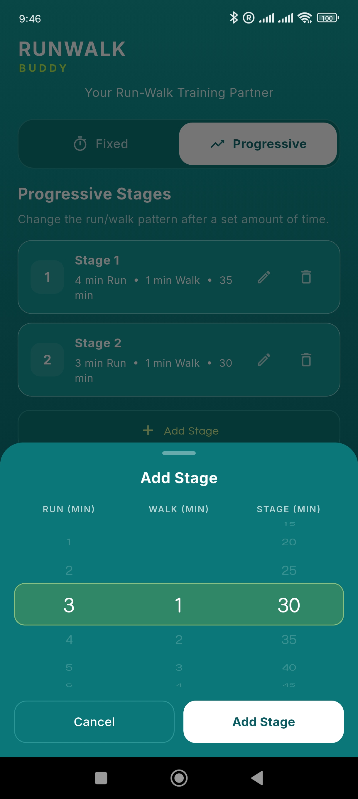
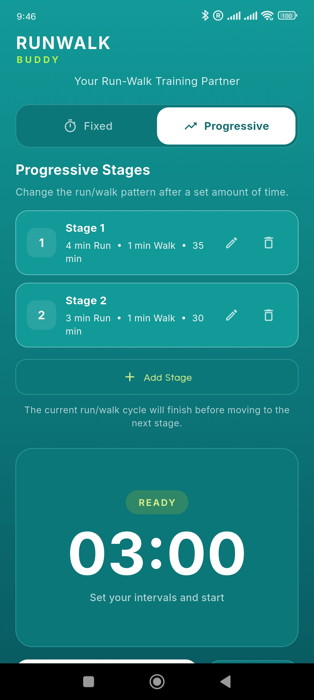
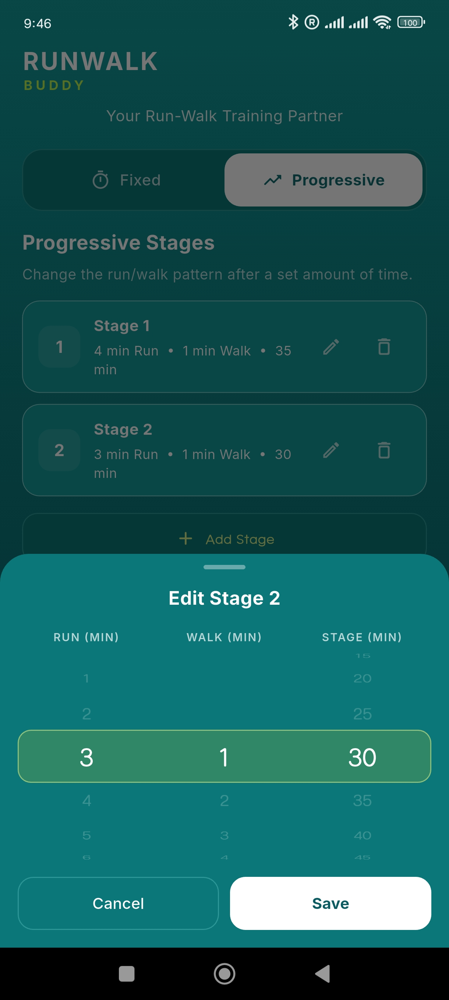

# RunWalk Buddy 🏃

**A simple run/walk interval companion built with Flutter.**

RunWalk Buddy helps runners follow structured running and walking intervals without constantly checking their phone. It uses background timing, voice announcements, and notifications to make workouts easier to follow, including when the screen is locked.

## ✨ Features

- **Run/Walk Intervals** — Alternate between running and walking with configurable durations.
- **Fixed Mode** — Follow a consistent run/walk interval throughout your workout.
- **Progressive Mode** — Adjust interval stages as your workout progresses.
- **Voice Announcements** — Hear instructions when it's time to run or walk.
- **Background Timer** — Continue tracking intervals while the app is in the background.
- **Notifications and Vibrations** — Receive workout cues without needing to look at the screen.
- **Smartwatch Friendly** — Designed for use alongside an Amazfit smartwatch through its notification and vibration features.

## 🛠️ Built With

- Flutter
- Dart
- `flutter_foreground_task`
- `flutter_tts`
- `flutter_local_notifications`

## 🚀 Getting Started

### Prerequisites

- Flutter SDK
- Dart SDK
- Android device or emulator
- Android Studio or Visual Studio Code

### Installation

1. Clone the repository:

   ```bash
   git clone https://github.com/ebycloudins/run_walk_buddy.git
   ```

2. Navigate to the project directory:

   ```bash
   cd run_walk_buddy
   ```

3. Install dependencies:

   ```bash
   flutter pub get
   ```

4. Run the application:

   ```bash
   flutter run
   ```

## ⚙️ Configuration

The app is designed to support configurable run/walk intervals. The default interval is:

- **Running:** 3 minutes
- **Walking:** 1 minute

Progressive stages can be used to change the interval structure as the workout continues.

## ⌚ Smartwatch Compatibility

RunWalk Buddy is designed to complement the Amazfit GTR 2e by using phone notifications and vibration cues delivered through the companion app.

Compatibility and notification behavior may vary depending on the smartwatch, phone, operating system, and notification settings.

## 📁 Project Structure

The project uses separate services and models to organize its functionality.

- `notification_service` — Handles workout notifications.
- `foreground_timer_service` — Manages background timer functionality.
- `tts_service` — Handles voice announcements.
- `progressive_stage` — Represents progressive workout stages.

*Exact paths and filenames may vary as the project evolves.*

## 🗺️ Roadmap

- [ ] Improve interval customization.
- [ ] Refine progressive workout stages.
- [ ] Improve background reliability and voice announcements.
- [ ] Enhance the workout experience with smartwatch notifications.
- [ ] Explore adaptive workout stages in future versions.

## 📱 Screenshots

<p align="center">
  
    
    
    
    
    
</p>

## 🤝 Contributing

Suggestions, bug reports, and contributions are welcome. Feel free to open an issue or submit a pull request.

## 📄 License

No license has been specified yet. Add a license before allowing others to reuse or distribute this project.

---

**RunWalk Buddy** — Focus on your run, and let the app guide your intervals.
